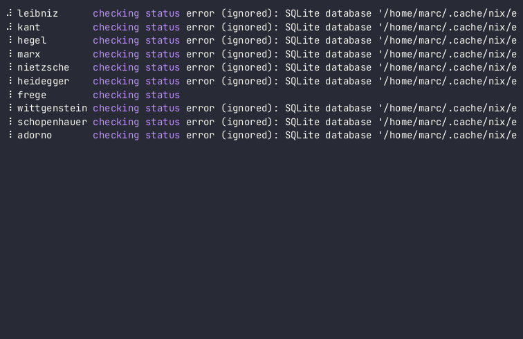

# Dance

`nixos-rebuild` can deploy a flake-based NixOS server with a single command:

```console
nixos-rebuild switch --use-substitutes --flake .#web-server --target-host root@www.example.com
```

`dance` wraps this in a nice utility to make it more comfortable:

[](https://asciinema.org/a/sSUw7XPxkSdJvDgL)

## What `dance` does for you

Dance keeps the complete `nixos-rebuild` operations and adds:

- An **inventory** list of hosts to deploy, mapping a flake output to a remote host.
- **Parallel execution** of all selected deployments.
- Status queries: evaluate the desired system locally, then check if the remote needs to be updated.
- **Rollback** including watchdog timers: if you lock yourself out of SSH, wait 6 minutes for it to revert automatically.
- **Deployment locks** to prevent accidental parallel Dance deployments.
- **Verification** of deployments: write a script to smoke-test a server, with automatic rollbacks on failure.
- **No local state**! `dance` does not rely on any mutable state, just immutable inventory. If your `flake.lock` is version controlled, you can run it on any machine without having to ensure any sort of deployment state is checked in.

## Writing an inventory file

An inventory contains any number of hosts with three fields:

```toml
# `www` is the ID used on the command line and in output.
[hosts.www]
# Hostname or SSH configuration alias used to reach the machine.
ssh_host = "www.example.com"
# Flake directory, relative to this inventory.
flake_path = "../production"
# Server configuration within the flake.
flake_name = "web-server"
```

Pass the file using `-i/--inventory` or set `DANCE_INVENTORY` instead.

## Querying the status quo

The `status` command can be used to query the status quo:

```console
$ dance -i invenstory.toml status
```

will query every host, which performs the following steps:

1. Read each host's active system from `/run/current-system` via SSH.
2. Evaluate the desired system store path from `flake_path#flake_name` out inventory.
3. Run a verifier against the system (see "verifiers" below).
4. Report whether the system needs to be updated.

This is run for all servers in parallel.

## Deploying servers

Using `deploy` instead of `status` will perform everything `status` does and then offer a confirmation prompt. If you answer `y` there (or passed `--yes`), `dance` will, for each server:

1. Acquire a deployment lock, to prevent multiple dance runs conflicting.
2. Build and upload the desired system with `nixos-rebuild dry-activate`.
3. Arm a rollback watchdog and temporarily activate the system with `nixos-rebuild test`. Note that `test` is a bit of misnomer, this activates the system except for updating the boot loader.
4. Run the configured verifier against the system.
5. Persist the system with `nixos-rebuild switch`.
6. Disarm the watchdog.
7. Garbage collect down to a configurable number of kept generations.

A failed activation or verifier immediately restores the previous system. If Dance exits or loses contact first, the watchdog performs the same restoration when its deadline expires.

## Updating flake inputs

Pass `--update` to run `nix flake update` once for each selected flake before Dance evaluates its desired systems:

```console
$ dance status --update
$ dance deploy --update
```

The updated `flake.lock` remains in the worktree for review. For deployments, add `--commit` to commit changed lock files after every selected host has deployed successfully; `--git` is shorthand for `--update --commit`:

```console
$ dance deploy --update --commit
$ dance deploy --git
```

## Verification

A flake can optionally provide a runnable verifier with the same key as its NixOS configuration:

```nix
danceVerifiers.${system}.web-server = pkgs.writeShellApplication {
  name = "verify-web-server";
  runtimeInputs = [ pkgs.hurl ];
  text = ''
    hurl --test <<'EOF'
    GET https://www.example.com/
    HTTP 200
    EOF
  '';
};
```

Dance runs the verifier on the deployment machine with `DANCE_HOST_ID` and `DANCE_SSH_TARGET` in its environment. The verifier can use the latter for internal checks such as `ssh "$DANCE_SSH_TARGET" systemctl is-active caddy.service`.

Run verifiers without deploying:

```console
dance verify www
```

## Logs

Dance keeps command output under `$XDG_STATE_HOME/dance/logs` when a run fails, falling back to `~/.local/state/dance/logs` when `XDG_STATE_HOME` is unset. Each retained run contains a `run.log` tracing log and numbered raw output streams for its commands. Use `--logs always` to keep successful runs, `--logs never` to disable logs, or `--logs-dir` to change their location.
